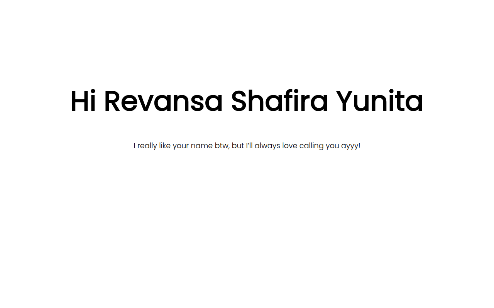

# Happy Birthday Revansa

Website ucapan ulang tahun interaktif satu halaman. Halaman menampilkan rangkaian animasi ucapan secara berurutan, mulai dari sapaan sampai balon dan lingkaran perayaan, disertai musik latar. Nama penerima, teks ucapan, foto, dan tanggal target diatur di berkas HTML dan JavaScript.

## Fitur

- Hitung mundur menuju tanggal ulang tahun yang ditampilkan sebelum animasi utama berjalan.
- Rangkaian adegan animasi berurutan yang digerakkan GSAP: sapaan, nama penerima, kotak chat berisi pesan, rangkaian ide ucapan, foto penerima dengan topi ulang tahun, teks Happy Birthday, balon yang naik, dan lingkaran perayaan.
- Dialog konfirmasi SweetAlert2 sebelum rangkaian animasi dimulai.
- Musik latar Happy Birthday yang diputar berulang dari berkas `music/hbd.mp3`.
- Tombol ulangi di akhir untuk memutar rangkaian animasi dari awal.
- Nama, teks sapaan, teks ucapan, dan foto penerima dapat diganti langsung di `index.html`. Tanggal target dan tahun lahir diatur di `script/main.js`.

## Teknologi

- HTML5 dan CSS3
- JavaScript
- GSAP 3.11.5 untuk animasi
- SweetAlert2 untuk dialog
- Font Poppins dari Google Fonts

## Cara Instalasi

Tidak ada proses build. Clone repositori ini dan situs siap dijalankan.

## Cara Menjalankan

Cara paling sederhana adalah menjalankan server statis dari folder repositori, lalu membuka alamatnya di browser:

```bash
python3 -m http.server 8000
```

Setelah itu buka `http://localhost:8000` di browser. Membuka `index.html` langsung dari berkas juga bisa, selama koneksi internet tersedia untuk memuat GSAP, SweetAlert2, dan font dari CDN.

## Tangkapan Layar



## Lisensi

Proyek ini memakai lisensi MIT. Lihat berkas [LICENSE](LICENSE) untuk teks lengkapnya.
